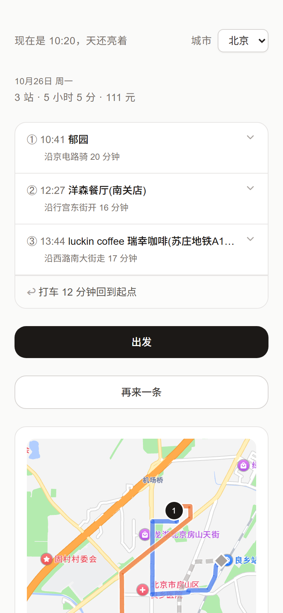
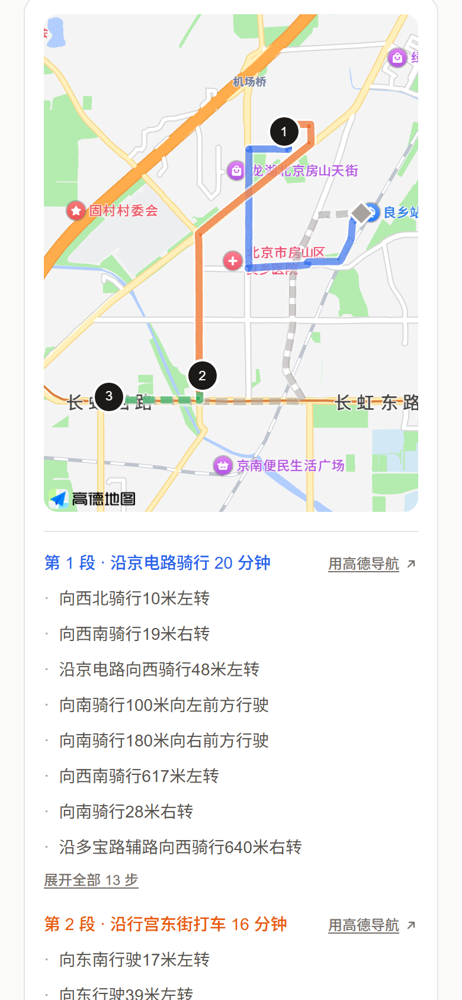

# 说走就走

给出一个起点和一个回家时间，排出一条能照着走的半日路线。

> 当前版本：2026-10-26。仓库自带一个示例城市（15 个手工编写的点位，用来跑通流程）；
> 真实地点数据请用 `npm run fetch:seed` 自行采集。

<p align="center">
  
  
  
</p>

<p align="center">
  <sub>① 问四五个问题就知道你要什么　② 3 站 / 5 小时 5 分 / 111 元，时间和花费都闭合　③ 沿道路画线，不是直线</sub>
</p>

> **关于数据**：`data/cities/example.json` 里的 15 个点位是手工编写的示例（坐标取自真实路网，
> 名称、营业时间、评分为演示用途），不来自任何第三方数据源，仅用于跑通流程和充当采集模板。
> 截图用的是作者本地采集的真实数据，不在仓库内。
>
> 高德开放平台的地点数据版权归原提供方所有，本项目不再分发；需要真实数据请自行按「数据怎么来的」一节采集，
> 并遵守高德开放平台的服务条款。

---

## 一、它解决什么问题

周末下午有空，但不知道去哪儿。

打开大众点评，你得先知道想吃什么、想逛什么，然后一家一家看。打开小红书，满屏都是网红店和广告。

**这个产品只回答一个问题：现在出门，接下来四个小时怎么过。**

不让你选，只给你一条线，你照着走就行。

---

## 二、现在能做什么

### 一次完整的行程

```
你选：出行风格 / 城市 / 起点 / 几点回家 / 想看什么 / 要不要吃饭
  ↓
它排：3–6 个地点，时间闭合、预算闭合、越走越远再走回来
  ↓
你看到：地址清单 + 真实地图上的路线 + 每一步怎么走的文字导航
  ↓
你点「出发」：手机锁屏、切到高德、被微信挤掉，回来还在
```

### 排程规则（都是硬约束，一条不满足就重排）

| 规则 | 说明 |
| --- | --- |
| 时间闭合 | 到达 + 停留 + 通勤 = 下一站到达，误差 ≤1 分钟 |
| 预算闭合 | 超预算的方案直接丢弃 |
| 环线形状 | 第一站最近，之后距离单调递增（允许 10% 回退），最后回起点 |
| 类目不重复 | 同一类目整条线最多 1 站；吃饭类（餐厅 + 咖啡）合计最多 2 站 |
| 同区域去重 | 同类目 800 米内不重复；第 3 站起不能回到前序站的 800 米内 |
| 营业时间 | 到达 + 停留 ≤ 闭馆；闭馆日排除 |
| 用餐时段 | 跨午餐/晚餐必须有餐厅（选「不用吃饭」时整条规则关闭） |
| 日落锚点 | 标了「日落」的点会前置到日落时刻附近，赶得上就去看 |
| 时长贴合 | 行程结束时间贴近你填的到家时间，差值 ≤30 分钟 |

### 两套出行风格

| | rich（高品质） | powerful（冒险） |
| --- | --- | --- |
| 想去 | 评分高的、有名的 | 没听过的、有偏门的 |
| 远区交通 | 打车，单程 ≤15 分钟 | 地铁/公交，单程 ≤45 分钟 |
| 预算 | 默认 400 | 默认 200 |
| 站数 | 少而精 | 多而杂 |

### 呈现

- **高德真实地图**：沿道路画线，不是直线
- **分段配色**：每段一色，半透明，重叠也分得清；返程用浅灰虚线
- **轨迹动画**：3.5 秒画完整条线，可点地图跳过
- **文字导航**：方向、路名、距离、路口，来自高德 steps
- **一键唤起高德 App**：手机上真的能导航
- **路线卡片**：1080×1920 PNG，可保存分享
- **LLM 文案**：每站一句话（≤20 字）+ 整份一句话，prompt 在后台可实时调

---

## 三、技术架构

```
Next.js 14（App Router）
  ├── app/page.tsx           首屏 + 问答 + 行程卡片 + 地图 + 导航
  ├── app/admin/page.tsx     后台：地点管理 + 地图
  ├── app/admin/prompt/      后台：文案 prompt 调优（实时预览）
  └── app/api/
        ├── plan/            排程主接口（最核心）
        ├── swap/            换一个（UI 已隐藏，接口保留）
        ├── cities/          城市列表
        └── admin/           后台 CRUD

lib/
  ├── planner.ts             排程引擎（4900+ 行，环线/类目/时长/锚点）
  ├── amap.ts                高德接口封装（POI 搜索、算路、geocode）
  ├── amapLoader.ts          高德 JS SDK 共享加载器
  ├── geolocation.ts         定位（已关闭，开关在 GEOLOCATION_ENABLED）
  ├── llmText.ts             文案生成
  ├── trip.ts                进行中行程的持久化（8 小时过期）
  ├── profile.ts             用户画像（localStorage）
  └── cityData.ts            城市数据读写 + manual 层合并

data/cities/
  ├── index.json             城市索引（仓库里只登记 example）
  ├── example.json           示例数据：15 个手工编写的点位
  └── example.manual.json    手工维护层（星标 / 隐藏 / 字段覆盖）

  ↑ 真实城市数据不进仓库，用 `npm run fetch:seed <city>` 自己采，落到同名文件

data/prompts/one-liner.json  文案 prompt（可在后台改）
```

**外部依赖**：高德 Web 服务 API（POI/算路）、高德 JS API（地图）、DeepSeek（文案）

---

## 四、怎么跑起来

```bash
# 1. 装依赖
npm install

# 2. 配环境变量
cp .env.example .env.local
# 填入：
#   AMAP_KEY               高德 Web 服务 Key（服务端用，必需）
#   NEXT_PUBLIC_AMAP_JS_KEY 高德 JS API Key（前端地图用，必需）
#   NEXT_PUBLIC_AMAP_SECURITY_CODE
#   LLM_API_KEY / LLM_BASE_URL / LLM_MODEL   （可选，不填就没有一句话文案）
#   ACTIVE_CITY=example     （仓库只带示例城市）

# 3. 启动
npm run dev
# → http://127.0.0.1:3000

# 4. 后台（仅本机可访问）
# → http://127.0.0.1:3000/admin
```

**示例数据开箱能跑**：`data/cities/example.json` 里已经写好 15 个点，
不采集数据也能走完「问答 → 排程 → 地图 → 文字导航」全流程，只是排出来的路线是演示点位。
想要真实可用的路线，按第五节「采集你自己的城市」做。

⚠️ **高德控制台要把安全域名加进去**：`127.0.0.1`（本机调试）+ 你部署的域名。**`localhost` 加不进去**（不是合法域名）。

⚠️ **两个 Key 性质不同**：`AMAP_KEY`（Web 服务）只在服务端用，务必保密；
`NEXT_PUBLIC_AMAP_JS_KEY` 会被打进浏览器包，**本来就藏不住**，安全性全靠控制台的
「安全域名白名单」和「数字签名」——部署前一定配好，否则别人的页面也能刷你的配额。

### 改完代码怎么验

```bash
npx tsc --noEmit        # 类型检查（strict 全开，必须零错误）
npm run lint            # ESLint
npm run build           # 生产构建
npm run check:city      # 城市数据契约校验（索引 / zod / 类目覆盖 / 3km 内免费点）
```

浏览器验收用 `scripts/verify/*.mjs`（自带 CDP 脚本，不依赖 puppeteer / playwright）。

⚠️ `npm run build` 和 dev server 共用 `.next`，跑完 build 要先删 `.next` 再起 dev，否则会报 `Cannot find module './xxx.js'`。

### 部署

Vercel 是最快的一条（不用备案）：

1. 仓库导入 Vercel，环境变量照 `.env.example` 填全
2. 高德控制台 → 对应 Key → 安全域名里加上 Vercel 分配的域名
3. `/admin` 线上会被 middleware 挡成 404，这是设计如此；不要为了看后台去开 `ADMIN_ALLOW_REMOTE`

国内服务器部署要 ICP 备案，高德 JS API 的安全域名同样得配。

---

## 五、数据怎么来的

**仓库自带的 `example.json` 是手工编写的示例**（15 个点，核心 6 类各 2 个以上），
坐标落在真实路网上所以地图和算路能正常工作，但名称、营业时间、评分都是演示用途。
它同时充当采集脚本的配置模板。

### 采集你自己的城市

```bash
# 1. 复制示例作为该城市的配置骨架，改 city / displayName / cityCode / districts / origin
cp data/cities/example.json data/cities/<your-city>.json

# 2. 登记到索引（页面上的城市切换读这里）
#    data/cities/index.json 的 cities 数组里加一条 { "city": "your-city", "displayName": "你的城市" }

# 3. 在 .gitignore 的数据白名单里补三行，否则采集结果不会被版本管理
#    !/data/cities/your-city.json
#    !/data/cities/your-city.manual.json
#    !/data/cities/your-city.events.json

# 4. 跑采集（需要 .env.local 里的 AMAP_KEY；有 LLM_API_KEY 时会顺便打风景标签）
npx tsx --env-file=.env.local scripts/fetch-seed.ts your-city

# 5. 打星（规则初筛 + LLM 校正，结果写进 <city>.manual.json 的 importance）
npx tsx --env-file=.env.local scripts/rate-places.ts your-city

# 6. 校验
npm run check:city
```

采集流水线本身长这样：

```
scripts/fetch-seed.ts <city>
  ↓
12 类关键词 × 高德 place/text + place/around（圆心 3km）
  ↓
清洗（去可疑 POI、补营业时间）
  ↓
LLM 打风景标签（sceneryType / bestTime / soloFriendly / oneLineDesc）
  ↓
tier 门槛校验（条数、类目覆盖、3km 内免费点数）
  ↓
写入 data/cities/<city>.json

scripts/rate-places.ts <city>
  ↓
规则初筛（名称含「塔/寺/博物馆」→4星；「便利店/打印」→1星）
  ↓
LLM 校正（"对本地人来说几星"）
  ↓
写入 <city>.manual.json 的 importance 字段
```

**作者本地采集时的观察**（这些数据不在仓库内，仅供参考）：

北京 116 个地点里只有 40 个 ≥3 星（34%），辽阳 141 个里有 33 个（23%）。
北京餐厅 20 家只有 1 家 ≥3 星、咖啡 16 家 0 家 ≥3 星——这一带的餐饮质量确实一般，不是采集问题。
高星点集中在公园（北京 23/38）和博物馆（北京 6/6），这也决定了排出来的线大多是「逛公园 + 看展」的形状。

**示例数据下 `npm run check:city` 会 FAIL，这是预期的**：那道门禁还校验「总条数 50–240」
和「3km 内免费点 ≥5」，15 个点的示例过不了条数这一关。它是给真实数据用的，
只跑示例数据时跳过即可。

---

## 六、目录说明

```
app/            页面与接口
components/     UI 组件（含 AmapRouteMap 地图、Onboarding 问答、TravelingView 进行中）
lib/            业务逻辑
data/           城市数据 + prompt
docs/           截图等仓库内文档素材
scripts/        数据采集、打星、验收脚本；scripts/verify/ 是 CDP 浏览器验收
types/          zod schema（唯一契约）
build/*.md      每轮的契约文档（怎么做的、验收什么）
middleware.ts   /admin 只允许本机访问
```

---

## 七、已知限制

| 限制 | 原因 |
| --- | --- |
| 仓库只带示例城市 | 真实地点数据涉及第三方版权，不宜二次分发；需要的话按「采集你自己的城市」自己采 |
| 示例数据只有 15 个点 | 够跑通全流程，但排不出丰富多样的线；想要真能用的路线得采真实数据 |
| 从五道口、三里屯填起排不出来 | 作者本地数据只覆盖房山 / 顺义，那些地方最近的点在 25 公里外 |
| 定位功能已关闭 | 高德定位在国内失败率高，先改成手填起点 |
| 「换一个」按钮已隐藏 | 会破坏环线形状（换到远处），等形状规则稳定再放出来 |
| 不能跨城规划 | 苏庄到顺义 50 公里，环线规则下只能是两个独立片区 |
| 晚上 22:30 后可能排不出来 | 时间不够一站，会如实说「明天早点」 |
| `/admin` 只允许本机 | 后台没有鉴权，靠 Host 判断挡住外部访问 |
| 没有公开在线 demo | 代码可部署（见「部署」），但仓库不挂常在线实例：高德 Key 按量计费，公开 demo 的 Key 会被刷 |

---

## 八、下一步该做什么

**产品层面（最该做）**：自己照着排出来的行程走一遍，记下哪一刻有用、哪一刻觉得蠢。

**功能层面**：

1. **数据补齐**（最高优先）—— 采集范围扩到 5–10 公里半径，补正餐类目，把 ≥3 星的点提到 100+
2. 部署上线（Vercel + 高德白名单，或国内服务器 + 备案）
3. 定位修好再打开（要摸清高德定位的失败率）
4. 补 planner 的单元测试（现在只有端到端验收脚本）

---

## 九、几条踩过的坑

**高德相关**

- `localhost` 加不进安全域名白名单，本地调试必须用 `127.0.0.1`
- `road` / `cost` 字段可能是空数组 `[]`，不是字符串，要判空
- 步行接口只返回一条路径，没有「备选方案」可挑
- 公交接口靠 `cityCode` 区分城市，北京要用 `110000`（区号 010 只有 3 位，过不了校验）

**Next.js 相关**

- `npm run build` 和 dev server 共用 `.next`，会互相破坏（`Cannot find module './948.js'`）。跑完 build 必须删 `.next` 再重启 dev
- `request.nextUrl.hostname` 在 dev 下不反映真实 Host，判断来源要用 `headers.get('host')`
- middleware 新增后可能不生效，要重启 dev server

**数据相关**

- `<city>.manual.json` 曾经存的是**全量副本**（会让重新采集失效）。已用 `scripts/shrink-manual.ts` 砍成 `{id, importance}`；重采前别再让它长回全量
- 高德的 `around` 接口在大半径下 `count` 字段不可信（3km 比 5km 还多）

**TypeScript 相关**

- 开 `strict` 后 `lib/planner.ts` 里出现过「属性访问退化成 `never`」：`best` / `bestDifferentCategory` 只在 `consider` 闭包里被赋值，TS 的控制流分析不把闭包赋值计入 CFG，于是 `if (x === null)` 被判成恒真、后面的 `x.foo` 全变成 `never`。解法是用断言把「闭包里已发生的赋值」补回类型层
- 同理，闭包里读外层 `let` 变量拿不到外层的判空收窄（`sourcePool` 那处），要在闭包内重新取一次并判空

---

## 十、许可证与数据来源

代码以 **MIT** 协议开源，见 [LICENSE](LICENSE)。

`data/cities/*.json` 里的地点数据采集自高德开放平台，仅用于本项目的功能演示与个人学习，
版权归原数据提供方所有。二次分发或商用前请自行确认符合高德开放平台的服务条款。
